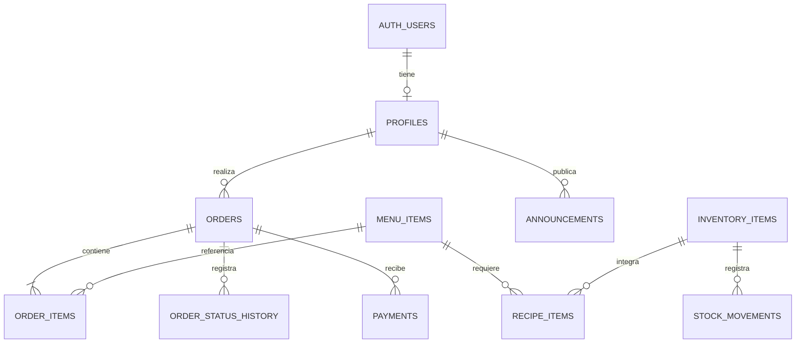

# Diagnóstico y plan: gestión de desayunos

Fecha: 22 de octubre de 2026.

> Este documento conserva el diagnóstico inicial. La implementación posterior, las migraciones y el alcance todavía pendiente están descritos en [SUPABASE.md](SUPABASE.md).

## 1. Alcance de esta revisión

Se revisaron los archivos actuales del proyecto Android, sus pruebas y configuración, y el esquema SQL y las políticas compartidas en el chat. El diagrama adjunto coincide con las relaciones principales del SQL. No se accedió al proyecto remoto de Supabase: no se verificaron datos, permisos efectivos, RLS habilitado, triggers, índices adicionales, Storage ni Realtime en el servidor.

Había cambios locales previos en `models.kt`, `SupabaseClient.kt`, `DesayunoRepository.kt`, `AuthScreen.kt` y `DesayunoViewModel.kt`. Se conservaron. Este documento propone trabajo futuro; no es una migración ejecutable ni modifica el backend.

## 2. Estado actual de Android

Existe una base de prototipo con Kotlin, Jetpack Compose, Material 3, ViewModel, StateFlow, coroutines y llamadas HTTP con OkHttp/Gson. La actividad de entrada utiliza Compose; también permanecen layouts XML. No hace falta reescribir la interfaz para avanzar.

| Módulo | Implementado | Pendiente principal |
| --- | --- | --- |
| Acceso | Pantallas de registro y login de cliente/cocina | Sesión real, UUID de Auth, renovación y autorización por rol |
| Catálogo | Categorías, imágenes y productos de ejemplo; envío de productos a Supabase | Lectura remota, errores visibles y disponibilidad persistida |
| Carrito | Cantidades y total local | Revalidación de precio y stock al confirmar |
| Pedidos | Creación local y envío de cabecera y detalles | Transacción, lectura remota, propietario y reintentos seguros |
| Cocina | Cola y cambio de estado local | Persistir estados y compartir cambios entre teléfonos |
| Inventario | Valores locales y envío tras crear pedido | Reservas atómicas, recetas, movimientos y persistencia de ajustes manuales |
| Avisos | Publicación en memoria | Persistencia y lectura compartida |
| Reportes | Suma local de pedidos READY y DELIVERED | Pagos, filtros por jornada y métricas consistentes |
| Notificaciones/widget | Notificaciones locales y widget | Aviso al dispositivo del cliente y recuperación tras reiniciar |

## 3. Hallazgos priorizados

Las referencias son relativas a la raíz del repositorio.

| Prioridad | Evidencia | Consecuencia y corrección |
| --- | --- | --- |
| P0 | `network/SupabaseClient.kt`, funciones de login/registro | Hay rutas que devuelven éxito ante errores de red, respuestas 5xx o contraseñas de prueba. Eliminar estos accesos alternativos; separar cualquier demo en una variante explícita de desarrollo. |
| P0 | Políticas compartidas: ALL, public, USING true, WITH CHECK true | Si RLS está activo y los grants permiten operar, estas políticas permiten acceso general, incluso anónimo. Sustituirlas por permisos mínimos y probar denegaciones. Agregar políticas restrictivas sin retirar las permisivas no resuelve el acceso. |
| P0 | `loginAdminWithSupabase`, `DesayunoViewModel.loginUser` | Un login válido no verifica el rol en profiles; Android asigna COOK y crea otro UUID. Obtener identidad real y rol autorizado del servidor. `switchRole()` también debe eliminarse del flujo de producción o limitarse a permisos reales; su existencia no prueba que hoy esté expuesto en la UI. |
| P0 | Cabeceras de Database y Storage en `SupabaseClient.kt` | Se usa la anon key como Bearer después del login y se descarta la sesión. Usar access_token del usuario, renovar sesión y manejar expiración. La clave pública no sustituye el JWT del usuario; nunca distribuir service_role en Android. |
| P0 | `DesayunoRepository.placeOrder`, `saveOrderToSupabase` | Se anuncia éxito antes de confirmar el servidor, se envían cabecera y detalles en solicitudes distintas y se ignora el Boolean de sincronización. Puede haber pedidos incompletos o solo locales. Crear una RPC transaccional y estados de carga/error. |
| P1 | `nextOrderNumber = 101` y envío explícito de order_number | Cada proceso genera números coincidentes y omite el default de la secuencia. Generar el número exclusivamente en PostgreSQL y devolverlo. |
| P1 | Catálogo de ejemplo con UUID fijos | Un UUID sintácticamente válido no asegura que el producto exista en menu_items. Los detalles pueden fallar por FK. Cargar catálogo remoto o preparar datos de prueba mediante una migración controlada. |
| P1 | Repository usa StateFlow con listas iniciales; no hay lectura remota de negocio | Cliente y cocina no comparten el estado y al morir el proceso se pierden los datos locales. Incorporar carga inicial, refresco y persistencia. |
| P1 | `ClientScreens.kt`, myOrders filtra por customerName | Dos clientes con el mismo nombre pueden compartir resultados locales. Vincular y filtrar mediante customer_id; RLS debe proteger también el acceso directo a la API. |
| P1 | `placeOrder` resta stock con coerceAtLeast(0) | Oculta faltantes y no impide ventas simultáneas de la última unidad. Validar disponibilidad y reservar stock dentro de la transacción del servidor. |
| P1 | `updateOrderStatus`, `updateStockInventory`, `postAnnouncement` | Estos cambios son locales. Persistirlos, gestionar errores y refrescar otros dispositivos. La notificación de pedido listo se dispara en el dispositivo que cambia el estado. |
| P2 | `models.kt` usa Double para dinero | Usar céntimos enteros o BigDecimal con un contrato JSON definido; calcular importes definitivos en PostgreSQL. |
| P2 | `getSalesSummary` incluye READY y no filtra fecha/pago | Pedidos listos no equivalen a cobros. Separar ventas cobradas, pedidos entregados, unidades vendidas y cancelaciones. |
| P2 | `uploadImageToSupabase` devuelve una URI local si falla | Otro teléfono no podrá abrirla; mostrar fallo/reintento, persistir solo una referencia remota confirmada y cerrar response también en éxito. |

Los archivos citados de modelo, red, repositorio y UI están en `app/src/main/java/com/example/desayuno/`.

## 4. Relaciones actuales de Supabase

| Relación | Cardinalidad | Evaluación |
| --- | --- | --- |
| auth.users.id → profiles.id | Un usuario puede tener 0 o 1 perfil; cada perfil tiene 1 usuario | La FK y PK son adecuadas. No garantizan que todo usuario tenga perfil: falta verificar un trigger o flujo idempotente de creación. |
| orders.id → order_items.order_id | Un pedido puede tener 0..N detalles; cada detalle tiene 1 pedido | Estructura adecuada, pero la FK no exige al menos un detalle por pedido. Asegurarlo en la RPC. |
| menu_items.id → order_items.menu_item_id | Un producto puede aparecer en 0..N detalles; cada detalle referencia 0 o 1 producto | La referencia opcional requiere una regla explícita. Preferir desactivar productos y conservar referencias/historial. |
| profiles → orders | Ausente | Agregar customer_id para propiedad, historial y RLS. |
| stock_inventory → menu_items | Ausente | No hay receta ni equivalencia entre litros, vasos, panes y combos. |
| announcements → profiles | Ausente | Agregar autor para trazabilidad si se necesita. |

En `order_items` aparecen dos FK equivalentes para order_id y dos para menu_item_id. No representan relaciones diferentes. Conservar una por columna tras revisar dependencias. Pueden provocar ambigüedad en consultas anidadas de PostgREST; verificar el catálogo real antes de eliminarlas.

Los campos `menu_item_name` y `unit_price` en detalles son útiles como fotografía histórica: un cambio posterior de nombre o precio no debe alterar un pedido anterior.

## 5. Modelo recomendado

Para el MVP se propone un negocio con retiro en local, clientes registrados y roles CLIENT, COOK y ADMIN. Son supuestos de planificación, no requisitos ya confirmados. Si se permitirá compra como invitado, definir un flujo específico de identidad y consulta del pedido.

El diagrama representa reglas de negocio propuestas; el mínimo de un detalle por pedido requiere validación transaccional.

### Cambios del MVP

- `profiles`: rol NOT NULL limitado a valores permitidos; asignación de personal solo por administración confiable. El usuario puede editar sus datos de contacto, pero no su rol. Revisar eliminación de cuentas e historial antes de elegir CASCADE o anonimización.
- `orders`: agregar `customer_id uuid REFERENCES profiles(id)`, `updated_at`, `request_id` para idempotencia y marcas de preparación, listo, entrega y cancelación. Conservar nombre/teléfono como datos históricos, retirar el teléfono ficticio por defecto y establecer una política de retención.
- `order_items`: conservar una FK por relación; definir `quantity > 0`, `unit_price >= 0` y subtotal calculado por el servidor. Si se autoriza eliminar productos físicamente, acordar SET NULL y adaptar `OrderItem.menuItemId` a nullable; hoy Kotlin exige String.
- `menu_items`: precio con precisión y escala acordadas, stock no negativo, categoría validada, `is_available NOT NULL`, `updated_at` y desactivación en vez de borrado. Respetar is_available al guardar: el servicio actual siempre envía true.
- `orders.status`: limitar a PENDING, PREPARING, READY, DELIVERED y CANCELLED. Controlar transiciones en servidor, motivo de cancelación y devolución de reserva una sola vez.
- `order_status_history`: pedido, estado anterior/nuevo, actor y fecha, escritos junto con la transición.
- Índices: revisar los existentes; agregar índices de FK y consultas frecuentes, como `order_items(order_id)`, `order_items(menu_item_id)`, `orders(customer_id, created_at)` y `orders(status, created_at)`. Una FK no crea automáticamente un índice en la columna que referencia.
- Fechas: conservar timestamptz, usar `now()` como default y convertir para presentación/jornada a America/Lima. `timezone('utc', now())` produce timestamp sin zona y puede reinterpretarse al guardarlo; revisar timezone de sesión y datos antes de cambiar defaults.

### Inventario: escoger una estrategia antes de implementar

Para empezar, puede usarse solamente stock de productos vendibles en `menu_items`, reservándolo al confirmar el pedido. Evitar mantener un segundo contador independiente como si representara lo mismo.

Para gestionar insumos reales, reemplazar progresivamente las columnas fijas de `stock_inventory` por:

| Tabla | Campos principales | Propósito |
| --- | --- | --- |
| inventory_items | id, name, unit, minimum_stock | Catálogo extensible de insumos, usando unidades base como ml, g o unidad |
| recipe_items | menu_item_id, inventory_item_id, quantity_required | Consumo por producto y tamaño de porción |
| stock_movements | id, inventory_item_id, quantity_delta, reason, order_id nullable, actor_id, created_at | Compras, consumo, merma, ajustes y devoluciones auditables |
| combo_components, si corresponde | combo_menu_item_id, component_menu_item_id, quantity | Componentes de combo; evitar ciclos y descontar cada insumo una sola vez |

Si se guarda un saldo además del registro de movimientos, actualizar ambos en la misma transacción. Los litros enteros actuales no representan porciones fraccionarias. Para mantener temporalmente `stock_inventory`, definir si es una fila global o una fila por jornada/local: la PK aleatoria no limita la tabla a una fila y Android actualmente escribe un UUID fijo.

## 6. Seguridad y contrato de operaciones

Matriz objetivo; las RPC también deben verificar identidad, permisos y reglas de negocio.

| Recurso | Cliente | Cocina | Administración |
| --- | --- | --- | --- |
| profiles | Leer/editar contacto propio | Leer perfil propio y datos operativos necesarios | Gestionar personal y roles mediante operación restringida |
| menu_items | Leer carta visible | Leer carta | Crear/editar y desactivar |
| orders/order_items | Crear por RPC; leer propios | Leer cola y transicionar por RPC | Consultar y gestionar con auditoría |
| inventario | Ver disponibilidad derivada | Leer lo necesario | Registrar entradas, ajustes y merma |
| announcements | Leer vigentes | Leer | Publicar/editar |
| payments | Consultar propios | Solo si el rol también cobra | Registrar/verificar y reportar |
| Storage | Leer imágenes publicadas | Leer | Subir/editar archivos autorizados |

Retirar las políticas ALL/public permisivas e implementar políticas por operación para authenticated con `auth.uid()`. No permitir que el cliente se adjudique un rol privilegiado, cambie precios históricos, importe total o stock. RLS limita filas; para impedir cambios de `role` se necesitan permisos de columnas o una operación restringida, no solo una política de fila propia. Revisar grants además de políticas y habilitación de RLS.

Contrato propuesto de `create_order(request_id, items)`:

1. Validar sesión y perfil; derivar customer_id del JWT, no del parámetro del cliente.
2. Validar carrito no vacío, cantidades positivas, productos existentes/disponibles y límites razonables. Consolidar IDs repetidos.
3. Resolver request_id con unicidad por cliente y comprobar que un reintento corresponde a la misma solicitud.
4. Bloquear saldos necesarios en orden estable, comprobar disponibilidad y reservar/descontar sin permitir negativos.
5. Leer precios actuales del servidor, calcular detalles/total, generar número con secuencia y guardar cabecera, detalles e historial en una sola transacción.
6. Ante cualquier fallo, revertir todo; devolver pedido confirmado, número y total. Android solo entonces confirma y vacía el carrito.

Una operación de estado debe validar la transición y el rol, usar condición sobre el estado anterior y escribir historial en la misma transacción. Los reintentos no deben duplicar cobros, detalles ni devoluciones.

Preferir funciones SECURITY INVOKER cuando los permisos lo permitan. Si se requiere SECURITY DEFINER para encapsular escrituras, fijar search_path, calificar objetos, comprobar auth.uid()/rol y restringir EXECUTE; no convertir la función en una vía para eludir controles. Bloquear escrituras directas que permitan saltarse las reglas transaccionales.

## 7. Arquitectura Android propuesta

Mantener Compose → ViewModel → repositorios → fuentes remotas/locales. Separar progresivamente AuthRepository, MenuRepository, OrderRepository e InventoryRepository, con DTO distintos de los modelos de UI. Migrar por flujo sin reescribir toda la app.

- Sustituir el singleton de datos de ejemplo como fuente de verdad por consultas reales y resultados de servidor.
- Representar estados de carga, datos, vacío, error y sesión expirada. Propagar errores en vez de devolver éxito ficticio.
- Administrar sesión y cancelación de coroutines; evitar scopes sueltos por operación. Una librería de Supabase puede simplificar la sesión, pero no es obligatorio abandonar OkHttp si se implementa el contrato completo.
- Carga inicial y refresco al recuperar foco; Realtime para actualizaciones en primer plano. Reconectar y recuperar estado después de cortes.
- Room y WorkManager pueden agregarse para caché/reintentos cuando se necesiten. Durante el MVP, un pedido sin conexión no se presenta como confirmado.
- Para avisos con la app cerrada, integrar push mediante un servicio de backend y FCM. Realtime por sí solo no garantiza recepción con el proceso cerrado.
- Configuración por entorno y claves públicas en BuildConfig/configuración local; no guardar secretos de servidor en el APK. No registrar tokens ni contraseñas en logs.

## 8. Plan de implementación y aceptación

| Etapa | Entregables | Criterio para terminar |
| --- | --- | --- |
| 0. Base verificable | Compilación, lint y pruebas; documentar entorno; aislar demo | Proyecto compilable y fallos de entorno diferenciados de fallos del código |
| 1. Acceso seguro | Sesión real, UUID, perfiles, roles, RLS y Storage | Error de red no inicia sesión; un cliente no obtiene permisos de cocina ni puede editar su rol |
| 2. Datos del MVP | Migraciones versionadas, FK limpias, customer_id, restricciones, lectura remota | Carta/pedidos sobreviven al reinicio y dos clientes con igual nombre mantienen historias separadas |
| 3. Pedido transaccional | RPC, secuencia, stock, idempotencia, estados y errores de UI | Dos teléfonos compiten por la última unidad: solo uno confirma; reintentar no duplica pedido |
| 4. Operación compartida | Cola de cocina, historial, sincronización y avisos | Cambio de cocina se ve en cliente; reconexión recupera cambios; transición inválida se rechaza |
| 5. Gestión comercial | Pagos manuales, cierre diario, reportes por fecha, movimientos de stock | Cobros y entregas se reportan por separado; cierre concilia pagos confirmados |
| 6. Mejoras | Recetas, combos, programación, push y caché según prioridad | Cada mejora tiene prueba de uso real y no rompe permisos, precios ni inventario |

El orden refleja dependencias. No se fija un plazo sin conocer equipo, dedicación y alcance de pagos/inventario.

## 9. Funciones que conviene agregar

**Para el MVP:** perfil y teléfono reales, historial propio, cancelación con reglas, disponibilidad/agotados, cierre de recepción de pedidos por horario, stock confiable, errores y reintentos visibles, búsqueda de pedidos, ventas por jornada y separación entre cocinero y administrador.

**Después del flujo básico:** pagos registrados por caja (efectivo/Yape/Plin con estado y verificación por personal autorizado), comprobante interno y código QR de retiro, alertas de stock mínimo, mermas, recetas y costos para margen, tamaños de bebidas, personalización y alérgenos, pedidos programados con cupos y promociones. Un comprobante interno no constituye por sí solo un comprobante tributario. Una captura de pago tampoco debe confirmar automáticamente el cobro.

**Según crecimiento:** varias sedes, proveedores y compras, fidelización, reparto y exportación de reportes. Estas funciones amplían el modelo y se deben priorizar después de validar el negocio de un local.

## 10. Pruebas necesarias y despliegue de datos

Verificación ejecutada: `gradlew.bat :app:testDebugUnitTest :app:lintDebug --console=plain` terminó con BUILD SUCCESSFUL. Pasaron 2 pruebas unitarias, sin fallos ni errores. Lint reportó 0 errores, 334 advertencias y 1 sugerencia; esto no certifica la seguridad ni el funcionamiento de Supabase. Entre las advertencias revisadas está el formato monetario dependiente del locale. Reportes: `app/build/reports/tests/testDebugUnitTest/index.html` y `app/build/reports/lint-results-debug.html`. El primer intento offline no pudo resolver dependencias ausentes; la ejecución con descarga habilitada completó la revisión. No se ejecutaron pruebas en emulador/dispositivo ni pruebas contra el backend.

Las dos pruebas unitarias actuales comprueban datos iniciales, pero no cubren autorización, transacciones, red ni concurrencia. La prueba instrumentada incluida es básica. Agregar pruebas de comportamiento para:

- Cliente A no puede leer/modificar pedidos de B; anon no puede escribir; cliente no puede cambiar rol/precio/stock; cocina no puede administrar personal.
- Fallo de detalles revierte cabecera y stock; compra simultánea no genera sobreventa; reintento devuelve el mismo pedido.
- Reinicio de app recupera sesión/datos; sesión expirada requiere renovación o login; corte de red no produce confirmación falsa.
- Cancelación devuelve reserva una sola vez según regla; cambios de precio no alteran el historial; ventas y pagos respetan la jornada de Lima.
- Cocina y cliente en dispositivos distintos comparten estados; Storage impide uploads no autorizados.

Antes de migrar: obtener respaldo, comprobar esquema real y datos inconsistentes, probar en un entorno de ensayo, agregar customer_id inicialmente nullable si hay pedidos históricos y definir su conciliación sin asociarlos por nombre automáticamente. Revisar roles existentes antes de imponer CHECK/NOT NULL. Después, desplegar Android compatible y endurecer restricciones según la estrategia de actualización; no ejecutar el SQL contextual del chat como migración.

## 11. Fuentes oficiales de apoyo

- [Supabase: Row Level Security](https://supabase.com/docs/guides/database/postgres/row-level-security): políticas por usuario y operación.
- [Supabase: gestión de usuarios](https://supabase.com/docs/guides/auth/managing-user-data): perfiles vinculados a auth.users.
- [Supabase: funciones de base de datos](https://supabase.com/docs/guides/database/functions): operaciones de datos y seguridad de funciones.
- [PostgREST: relaciones entre recursos](https://docs.postgrest.org/en/v13/references/api/resource_embedding.html): relaciones inferidas desde FK y ambigüedad con varias FK.
